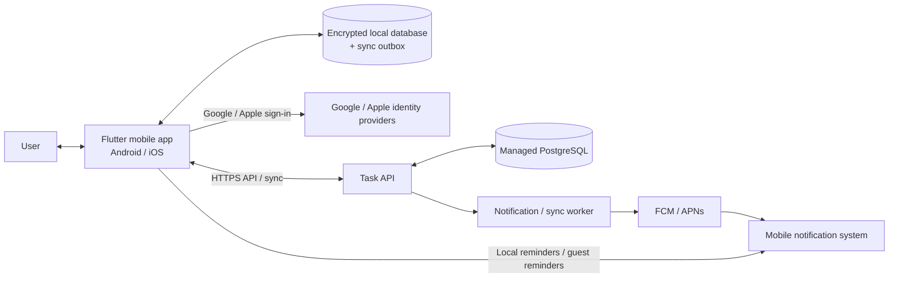
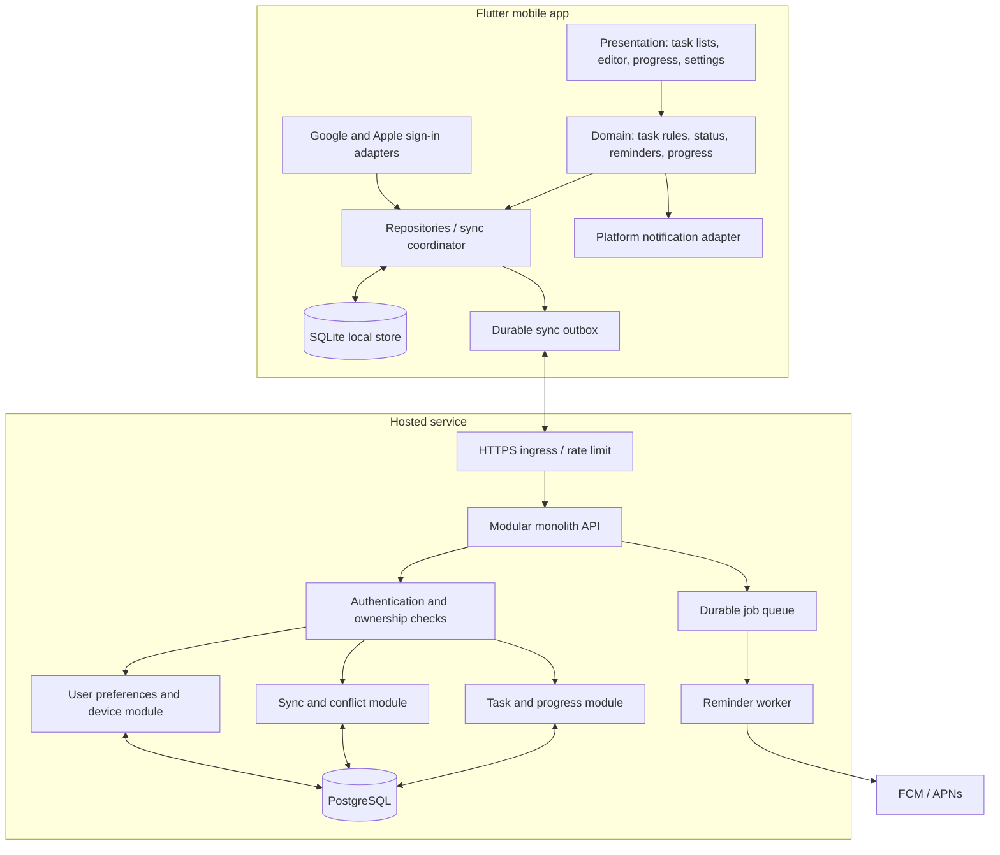

# High-Level Design (HLD)

**Project:** Personal and public task planning mobile application  
**Document status:** Reviewed; implementation baseline selected  
**Version:** 0.4  
**Date:** 16 October 2026  
**Requirements baseline:** [FRS.md](FRS.md) version 0.5

## 1. Purpose

Describe the system shape, major components, data flow, scaling path, and key technical decisions for the mobile task application. This HLD is a bridge between the approved product requirements and the detailed LLD. The user approved the HLD and delegated remaining implementation choices; this revision selects a concrete starting stack while leaving exact capacity and service-level targets to measured workload planning.

## 2. Executive summary

Build a cross-platform Flutter mobile app with a SQLCipher-encrypted Drift/SQLite local store and a small, stateless Java/Spring Boot backend API. Host the modular monolith on Google Cloud Run with Cloud SQL for PostgreSQL in Mumbai (`asia-south1`). Use Cloud Tasks for retryable reminder delivery, with controlled fan-out and capacity review before large-scale launch. The mobile app remains useful offline; signed-in users sync through an explicit versioned sync API that detects field conflicts and asks the user to resolve them. Guest data stays on-device until transferred to a Google or Apple account.

This structure supports a personal prototype without requiring microservices. The API, background jobs, and database can scale independently as public usage grows. A long-term aspiration of 10 million users is recorded, but scale capacity must be planned from active users, peak requests, sync volume, and notification delivery rate rather than registration count alone.

### Recommended decisions

| Area | Recommendation | Why |
|---|---|---|
| Mobile | Flutter for Android and iOS | One primary product codebase for the requested platforms; Flutter documents both Android and iOS as supported deployment platforms. [Flutter platform support](https://docs.flutter.dev/reference/supported-platforms) |
| Client data | Drift over SQLite with SQLCipher native builds; key held in OS secure storage | Typed local queries/migrations and offline transactions, with at-rest database encryption. SQLCipher Community Edition requires its license notices in an accessible app location. [SQLite/Dart encryption options](https://pub.dev/packages/sqlite3), [SQLCipher license](https://www.zetetic.net/sqlcipher/community/) |
| Mobile packages | `flutter_riverpod`, `drift`, `dio`, `google_sign_in`, `sign_in_with_apple`, `flutter_secure_storage`, `firebase_messaging`, `flutter_local_notifications` | Each has a narrow role; choose latest stable compatible releases at scaffold and commit exact lockfile versions. [Riverpod](https://pub.dev/packages/flutter_riverpod), [Drift](https://pub.dev/packages/drift), [Google Sign-In](https://pub.dev/packages/google_sign_in), [Sign in with Apple](https://pub.dev/packages/sign_in_with_apple), [FCM](https://pub.dev/packages/firebase_messaging) |
| Backend | Java 25 LTS + Spring Boot; JDBC repositories with parameterized SQL and Flyway migrations | Mature, strongly typed ecosystem and clear module boundaries; explicit SQL gives control over row locking and field-level sync conflicts. Spring Boot supports Java 25. [Spring Boot requirements](https://docs.spring.io/spring-boot/system-requirements.html), [Java roadmap](https://www.oracle.com/java/technologies/java-se-support-roadmap.html) |
| Cloud | Google Cloud Run (Mumbai) + Cloud SQL for PostgreSQL (Mumbai) | Aligns with the India target, Google sign-in, and FCM; keeps API stateless and database managed. Cloud Run supports `asia-south1`; Cloud SQL for PostgreSQL lists Mumbai. [Cloud Run regions](https://cloud.google.com/run/docs/locations), [Cloud SQL regions](https://cloud.google.com/sql/docs/postgres/region-availability-overview) |
| Queue and reminders | Cloud Scheduler trigger + Cloud Tasks dispatch queues; Firebase Admin SDK for FCM | Scheduled evaluation, controlled rate/retry, and push delivery. Rate limits and quotas require load testing and queue partitioning at scale. [Cloud Tasks configuration](https://docs.cloud.google.com/tasks/docs/configuring-queues), [FCM Admin SDK](https://firebase.google.com/docs/cloud-messaging/send/admin-sdk) |
| Server data | Cloud SQL for PostgreSQL, single-zone for development and regional HA for public launch | Relational constraints/transactions fit task history and deletion. Regional HA reduces zonal downtime but has a higher operating cost. [Cloud SQL HA](https://docs.cloud.google.com/sql/docs/postgres/high-availability) |
| Sync | Versioned, cursor-based API with field-level conflict detection | Meets offline requirements and the user's preference to resolve same-field conflicts rather than silently overwrite them. |
| Identity | Google sign-in on Android/iOS; Sign in with Apple also on iOS; local-only guest profile | Preserves requested Google sign-in and meets Apple's equivalent-login rule for third-party primary-account login. Guest use remains available without registration. [Apple App Review 4.8](https://developer.apple.com/app-store/review/guidelines/) |
| Privacy baseline | No advertising/cross-app tracking or product analytics in MVP; optional content-redacted crash diagnostics default off | Minimizes personal-data collection and avoids adding tracking SDKs before a clear need exists. |
| Platform baseline | Android 7.0/API 24 and iOS 15 minimum; target current store-required SDKs at submission | Matches Flutter's supported mobile platform floor in the current support matrix; store target SDK rules continue to move. [Flutter platform support](https://docs.flutter.dev/reference/supported-platforms), [Google Play target API](https://support.google.com/googleplay/android-developer/answer/11926878) |
| Account deletion | In-app request and public web request page; active primary data removed within 7 calendar days; backups expire within 30 days | Meets platform deletion control direction and makes retention clear. Google Play requires an external web resource as well as an in-app path for account creation. [Apple deletion guidance](https://developer.apple.com/help/app-review/guideline-reference/5-1-1-account-deletion/), [Google Play deletion requirements](https://support.google.com/googleplay/android-developer/answer/13327111) |
| Notifications | Local reminders for guest mode; server-evaluated push reminders for signed-in users, with local fallback where practical | Server can evaluate account state at reminder time; guest data is unavailable to the server. OS delivery and dismissal remain under user/system control. |
| Backend shape | Start with one deployable API plus worker process; Cloud Run scales stateless instances; cap instances to protect PostgreSQL | Avoids premature microservices while allowing horizontal scaling. [Cloud Run autoscaling](https://docs.cloud.google.com/run/docs/about-instance-autoscaling) |

## 3. Goals, scope, and assumptions

### 3.1 System goals

- Deliver the FRS MVP for Android and iOS.
- Keep guest data on the device and allow transfer to a Google or Apple account.
- Keep signed-in task data private per account and available offline.
- Preserve original planned dates, progress, completion, and reopening events while a task exists.
- Detect conflicting edits made offline on different devices and present a user choice.
- Support a staged path from a personal build to a public service targeting India.
- Provide a clear path to add calendar and study-timer capabilities later without requiring them in this release.

### 3.2 In scope for this design

- Mobile app structure and local persistence.
- Authentication boundary, API, hosted data, and synchronization.
- Notification scheduling and platform constraints.
- Security, privacy, operations, and scale-out path.

### 3.3 Out of scope

- Calendar feature details; the user has deferred confirming whether it is included.
- Study timer behavior beyond leaving room for future sessions, independent or task-linked.
- Shared tasks, collaboration, social features, and public task visibility.
- Final review of [UI flows and wireframes](UI-Flow-and-Wireframe.md), hosting cost, and production SLOs.
- Multi-region disaster recovery and any scale-driven sharding.

### 3.4 Capacity assumptions to validate

- “10,000,000 users in India” is treated as a long-term registered-user aspiration, not a defined simultaneous or daily active load.
- Workload planning requires at least: registered users, monthly/daily active users, peak concurrent devices, average tasks per user, sync operations per active user, notification opt-in rate, and retention period.
- The system should scale by adding stateless API/worker instances and database capacity before considering service decomposition or sharding.

## 4. Architecture overview

### 4.1 System context

The mobile application owns the immediate user experience and local task copy. The backend owns cloud account data, authorization, synchronization, and server-evaluated account reminders. Guest data is never uploaded unless the user chooses to transfer it to an account.

### 4.2 Logical components

The module boundaries are code boundaries inside one deployable backend at first. They are not separate network services. This keeps operational load low while preserving clear ownership of task, sync, identity/preferences, and reminders.

## 5. Component responsibilities

### 5.1 Mobile app

- Present current, scheduled-later, and completed tasks.
- Validate basic input immediately; server repeats validation for account data.
- Read and write through repositories so UI code does not depend on local database or API details.
- Store tasks and progress locally for offline use.
- Store a durable outbox of account changes awaiting synchronization.
- Show clear sync state: local-only, pending, synced, or conflict needing attention.
- Schedule guest reminders locally and update/cancel them when tasks or progress change.
- Keep account tokens in platform-protected secure storage; do not put secrets in the task database.
- Require a deliberate action before migrating a guest profile to a Google or Apple account.

### 5.2 API service

- Validate identity tokens/session and enforce owner-based authorization on every request.
- Own task and progress business rules for hosted accounts.
- Provide versioned endpoints for CRUD, sync, device registration, notification preferences, and account deletion.
- Reject stale writes or return conflict metadata; never silently apply last-write-wins to a changed field.
- Rate-limit abusive traffic and enforce request size and pagination limits.
- Emit structured operational events without logging task descriptions or notification content unnecessarily.

### 5.3 PostgreSQL

- Store account, task, progress, completion/reopen, device, and reminder preference data.
- Enforce foreign keys and owner scoping; add database constraints for valid date/effort values.
- Use indexed access paths for owner + status + start/end date, and owner + task + event time.
- Use transactions for task deletion and related history deletion.
- Store UTC timestamps for events and use `Asia/Kolkata` as the product time zone in the first release. Date-only task fields remain calendar dates and are not shifted by UTC conversion.

### 5.4 Background worker and queue

- Process account reminder schedules and notification dispatch jobs.
- Retry transient provider failures with backoff and deduplication keys.
- Keep notification evaluation separate from API request latency.
- At higher scale, partition reminder evaluation by time bucket and user shard rather than scanning all users in one unbounded job.

## 6. Data and synchronization design

### 6.1 Logical entities

| Entity | Key fields / notes |
|---|---|
| UserAccount | Internal user ID, account state, created/updated timestamps. |
| ExternalIdentity | Provider name and provider subject (Google or Apple), linked to one internal user; provider subject is unique per provider. Email is optional and is not an identity-link key. |
| Task | UUID, owner ID, topic, subtopic, optional description, start date, planned end date, optional hard maximum end date, effort hours, status, row version, created/updated timestamps. |
| ProgressLog | UUID, owner ID, task ID, event time, one method type (percent / units / note), corresponding value, optional note if the chosen method permits it. Multiple events may be stored; one dated log suppresses that task's 10 PM reminder. |
| TaskLifecycleEvent | Completion/reopen events and event time, while the task exists. Deleting the task also deletes this history. |
| Device | User ID, device ID, push token (if enabled), last sync cursor, last-seen time, notification preferences. |
| Sync metadata | Client mutation ID, server version, per-field version metadata or prior base values, sync cursor, pending delete tombstone. |
| Guest profile | Local-only profile ID and tasks. No backend user row until transfer is chosen. |

The exact relational schema, indexes, and API payloads belong in LLD.

### 6.2 Offline-first flow

1. The app applies a user change transactionally to its local database and writes an outbox mutation with a stable mutation ID and base server version.
2. UI reflects the local result immediately and marks it pending sync.
3. When connectivity returns, the sync coordinator uploads pending mutations in order, with retries safe through idempotency keys.
4. Server validates ownership and fields, applies non-conflicting changes, and returns accepted server versions plus a delta cursor.
5. The client downloads changes since its last cursor and updates its local copy transactionally.
6. Same-field edits from two devices produce a conflict response containing the field, base value, local value, and server value. The user selects the retained value; resolution is sent as a new versioned mutation.
7. Different-field changes to one task can merge automatically if they do not violate a validation rule.

### 6.3 Conflict and deletion rules

- A mutation includes a task version and changed-field set. Server compares the submitted base to the latest server state.
- Non-overlapping field updates can merge. Same-field divergent updates require user resolution as requested.
- A delete creates a sync tombstone so offline devices learn that the task was removed. The tombstone contains only the minimum identifier/version needed for sync and is purged after known devices have advanced or after a bounded expiry policy.
- The task's progress and completion records are deleted in the same database transaction. Tombstones are not user-visible task history and must not restore deleted tasks.
- An edit arriving after a delete is rejected; the client reports that the task was deleted and offers no automatic resurrection.
- Account deletion revokes sessions immediately and removes active account-owned data within 7 calendar days. Backups expire within 30 days; retain a minimal deletion ledger for 90 days and replay it after restore. Disclose timing in-app and on the web deletion page.

### 6.4 Guest-to-account transfer

- Keep guest data local until the user confirms transfer.
- Authenticate the selected Google or Apple identity, then upload guest tasks and histories in an idempotent batch.
- Preserve local UUIDs where possible; server validates and assigns ownership.
- On success, switch the local profile to the account and retain a local cache for offline use.
- On failure, leave the guest profile intact and allow retry; never clear local data before server confirmation.

## 7. API shape (logical)

Use HTTPS JSON APIs with a versioned prefix. Endpoint names are examples for LLD, not finalized contracts.

| Capability | Example operation |
|---|---|
| Sign-in exchange | `POST /v1/auth/session` |
| Task CRUD | `GET/POST /v1/tasks`, `GET/PATCH/DELETE /v1/tasks/{taskId}` |
| Progress | `GET/POST /v1/tasks/{taskId}/progress`, `PATCH/DELETE /v1/progress/{logId}` |
| Sync upload | `POST /v1/sync/mutations` |
| Sync download | `GET /v1/sync/changes?cursor=...` |
| Device registration | `PUT /v1/devices/{deviceId}` |
| Reminder settings | `GET/PUT /v1/me/reminder-settings` |
| Account deletion | `DELETE /v1/me` |

API responses should include stable resource IDs, server versions, and machine-readable validation/conflict codes. Cursor pagination is required for task history and sync deltas.

## 8. Notification architecture

### 8.1 Reminder rules

- Product time zone: India Standard Time for the first release.
- No-active-task reminders: 9:00 AM and 12:00 PM, evaluated against tasks active today.
- End-of-day reminder: 10:00 PM if a task is active/incomplete and has no progress log dated today. One progress log for that task is sufficient to suppress it.
- User settings can change supported reminder times, quiet hours, and sound/vibration preferences.
- Lock-screen task summary is privacy-safe, e.g. “You have 3 tasks today”; do not include task names by default.

### 8.2 Account and guest behavior

- Signed-in users: server worker evaluates current cloud state near reminder time and sends a push to registered devices that opted in. Push is best effort; device permission, connectivity, battery policy, and provider delivery affect arrival.
- Guest users: app schedules local notifications from the local task store and recalculates schedules after every task/progress mutation and when the app starts. Reminders are best effort if the OS suppresses background work or notification permission is unavailable.
- After offline account edits, the device also refreshes its local reminder schedule; server schedules reconcile after sync.
- Deduplicate jobs by user, device, reminder type, and local date.

### 8.3 Persistent notification constraint

The mobile operating system owns notification display and controls. Android may show an ongoing notification only for an appropriate user-visible foreground operation; Android provides users a system workflow to stop apps with foreground services. [Android foreground-service stop controls](https://developer.android.com/develop/background-work/services/fgs/handle-user-stopping). iOS local notifications are presented through the system notification interface, where users can dismiss them. [Apple local notification behavior](https://developer.apple.com/library/archive/documentation/NetworkingInternet/Conceptual/RemoteNotificationsPG/SchedulingandHandlingLocalNotifications.html). Therefore, the app cannot guarantee an always-visible, impossible-to-dismiss task notification on both platforms.

For iOS, use the standard daily summary and scheduled reminders. For Android, evaluate an ongoing notification only while there is a valid foreground-service use case and make it user-controllable. This behavior needs a platform-specific prototype before release.

## 9. Security and privacy

- Use HTTPS/TLS for all client/server communication.
- Validate Google/Apple credentials server-side and map provider identities to an internal user ID; do not trust client-supplied owner IDs or auto-link by matching email.
- Enforce owner filtering in API authorization and database queries. Consider PostgreSQL row-level security as defense in depth after verifying operational fit.
- Encrypt hosted database, backups, and device secrets using managed key services; use platform secure storage for tokens.
- Do not use ads, cross-app tracking, or product analytics in MVP. Optional crash diagnostics are off until opt-in and redact task content, tokens, and unnecessary identifiers. Routine operational logs expire after 30 days, security/audit events after 90 days, and invalid or 90-day inactive push tokens are removed. Notification previews avoid task names by default.
- Separate guest storage from account storage. On sign-out, protect account cache and prevent the next guest/account from seeing another profile's records.
- Provide account deletion in-app and through a public web request page; disclose that active primary data is removed within 7 calendar days and backups expire within 30 days.
- Data export is a later release requirement; define an export format and authorization checks when that roadmap item is scheduled.
- Review India-specific privacy, app-store, and data-residency requirements with qualified owners before public launch; this HLD does not make a legal determination.

## 10. Scalability, performance, and reliability

### 10.1 Initial deployment

- One API deployment, one worker deployment, managed PostgreSQL primary with automated backups and high availability appropriate to launch risk.
- Keep API instances stateless so they can scale horizontally.
- Use a durable queue for reminder jobs and retryable background work.
- Use database connection pooling and bounded request concurrency.
- Keep the mobile cache focused on active/recent tasks; fetch older completed history with pagination.

### 10.2 Growth path

1. **Personal development:** local database and a small hosted development environment; test guest and account flows.
2. **Private pilot:** production-like managed database, backups, monitoring, rate limits, and isolated environments; measure actual usage.
3. **Public launch:** horizontal API/worker scaling, queue-based reminders, database HA, tested restore, security review, and operational on-call/support ownership.
4. **Growth toward 10 million registered users:** capacity-test with measured DAU/peak sync patterns; scale database vertically/read replicas, partition high-volume event tables if measurements justify it, and split independently scaling modules only when there is a clear bottleneck or team boundary.

Do not introduce sharding or microservices solely from the 10-million registration target. Daily active use, task history size, peak traffic, and notification delivery profile drive the actual design.

### 10.3 Capacity model inputs

Before production sizing, collect or estimate:

- Registered users, DAU/MAU, devices per account, and peak concurrent users.
- Reads/writes and sync mutations per active user per day.
- Average and p95 task count and progress logs per account.
- Peak-hour concentration (especially reminders at 9 AM, noon, and 10 PM IST).
- Push notification opt-in and delivery rates.
- Data retention and account/task deletion volume.

Then derive API throughput, database IOPS/storage, queue backlog tolerance, and peak notification fan-out. Set explicit latency, availability, RPO, and RTO targets with product/operations owners.

## 11. Deployment and operations

- Environments: development, staging, production, with separate credentials/data and controlled promotion.
- Use infrastructure-as-code and automated schema migrations with rollback/forward-fix procedures.
- Store secrets in a managed secrets service; never commit credentials.
- Monitor API latency/error rate, database saturation, sync conflict rate, outbox age, queue lag, push failures, and crash-free sessions.
- Use correlation IDs across app/API/worker without logging sensitive content.
- Define backup restore drills, incident ownership, app support process, and release rollback approach before public launch.
- Deploy first in Google Cloud `asia-south1` (Mumbai) for Cloud Run and Cloud SQL. Revisit region/DR only after cost, legal/privacy, SLO, and measured-load review; using an India region does not by itself settle every data-processing or compliance question.
- Keep separate GCP projects for dev/staging/prod. Use Cloud Build and Artifact Registry for repeatable container deployments, Secret Manager for credentials, and Cloud Logging/Monitoring for operations.

## 12. Key risks and mitigations

| Risk | Impact | Mitigation |
|---|---|---|
| Offline sync is more complex than a single-user local app | Lost or duplicated edits | Versioned mutation API, idempotency keys, conflict UX, and an early sync prototype. |
| Reminder delivery/background execution varies by OS | A reminder may be late or absent | Use OS-supported local/push mechanisms, permission onboarding, device testing, and describe reminders as best effort. |
| User expects truly undismissable cross-platform notification | Cannot guarantee on both platforms | Document platform behavior; prototype Android ongoing notification and use standard iOS notifications. |
| “10 million users” is not a traffic profile | Over/under-building | Get DAU/peak assumptions and capacity-test in stages before selecting database topology. |
| Hard deletion conflicts with offline devices/backups | Deleted data may reappear or persist temporarily in backups | Sync tombstones, reject late writes, cascade delete, and define bounded tombstone/backup retention. |
| Reminder fan-out can exceed default queue capacity at high active-user counts | Late reminders or backlog | Load-test opt-in volume; partition queues, request quota changes, or move to batched sharded delivery before scale requires it. Cloud Tasks documents a default 500 dispatches/sec per queue. [Cloud Tasks quotas](https://docs.cloud.google.com/tasks/docs/quotas) |
| Cloud SQL HA increases cost | Higher public-launch spend | Use a zonal instance for dev, regional HA before public launch based on the approved availability target; measure cost before rollout. |

## 13. Decisions and open items

### Architecture decisions recommended in this HLD

- Flutter client for Android and iOS.
- Local-first client storage with a durable outbox.
- Versioned REST API and modular-monolith backend.
- Google Cloud deployment in Mumbai: Cloud Run API/worker and Cloud SQL PostgreSQL.
- Java 25 LTS / Spring Boot API, JDBC SQL repositories, Flyway migrations.
- Drift/SQLite with SQLCipher local encryption; Riverpod state/repository wiring.
- Cloud Tasks for retryable reminder dispatch; FCM Admin SDK for signed-in push.
- Explicit sync conflict resolution; do not silently overwrite same-field changes.
- Google sign-in on both platforms, Sign in with Apple on iOS, local guest mode, and guest-to-account transfer.
- Local reminders for guest mode; server-evaluated push for signed-in mode.
- India Standard Time as initial product time zone.

### Resolve during implementation planning

- At scaffold, select the latest stable mutually compatible Flutter packages (no prereleases), pin the Flutter stable channel, and commit exact resolved versions in lockfiles; re-check platform/store compatibility at each release.
- Implement the selected token/session lifecycle, retention windows, quiet-hour rule, and sync schemas from the LLD as code-level configuration.
- Set service-level targets and load-test profile from expected DAU and peak demand.
- Decide calendar inclusion and schedule it separately if approved.
- Validate notification behavior on both operating systems before committing to store-release UX.

## 14. Source notes

- Flutter documents Android and iOS deployment support: [Supported deployment platforms](https://docs.flutter.dev/reference/supported-platforms).
- Firebase Firestore was considered as a rapid offline-first alternative. Its official documentation states that offline writes synchronize on reconnect and multiple changes to the same document use last-write-wins. That default does not meet the user's explicit same-field conflict choice, so this HLD recommends an explicit sync API instead of direct client-to-database sync. [Firestore offline behavior](https://firebase.google.com/docs/firestore/manage-data/enable-offline).
- Android documents that users can stop apps running foreground services from system UI: [Android foreground-service stop controls](https://developer.android.com/develop/background-work/services/fgs/handle-user-stopping).
- Apple's local notification guide documents user dismissal actions in the system notification interface: [Scheduling and handling local notifications](https://developer.apple.com/library/archive/documentation/NetworkingInternet/Conceptual/RemoteNotificationsPG/SchedulingandHandlingLocalNotifications.html).
- Spring Boot 4.1 supports Java 25 and provides the backend framework baseline: [Spring Boot requirements](https://docs.spring.io/spring-boot/system-requirements.html).
- Apple requires an equivalent privacy-preserving login option when third-party login is used for an app's primary account; this design adds Sign in with Apple on iOS: [App Review guideline 4.8](https://developer.apple.com/app-store/review/guidelines/).
- Google Play requires account creation apps to provide in-app deletion and a web deletion resource; Apple requires in-app deletion for apps that support account creation: [Google Play deletion](https://support.google.com/googleplay/android-developer/answer/13327111), [Apple deletion](https://developer.apple.com/help/app-review/guideline-reference/5-1-1-account-deletion/).
- India's DPDP Rules were notified with phased commencement dates; confirm current commencement and obligations with qualified counsel before launch: [MeitY Gazette notification](https://www.meity.gov.in/static/uploads/2025/11/53450e6e5dc0bfa85ebd78686cadad39.pdf).
- Java 25 is an LTS release; select a supported distribution and keep it on security updates: [Oracle Java SE roadmap](https://www.oracle.com/java/technologies/java-se-support-roadmap.html).
- Cloud Run supports Java applications: [Java runtime documentation](https://docs.cloud.google.com/run/docs/runtimes/java).
- Cloud Tasks supports configurable queue dispatch limits and retry behavior; quotas and schedule horizons must be accounted for. [Cloud Tasks queue configuration](https://docs.cloud.google.com/tasks/docs/configuring-queues), [quotas](https://docs.cloud.google.com/tasks/docs/quotas).
- SQLCipher Community Edition may be used in closed-source commercial apps under its BSD-style license with required user-accessible notices. [SQLCipher Community Edition](https://www.zetetic.net/sqlcipher/community/).

## 15. Revision history

| Version | Date | Change |
|---|---|---|
| 0.1 | 13 October 2026 | Initial HLD based on FRS v0.4; proposed cross-platform, local-first, scalable architecture for review. |
| 0.2 | 15 October 2026 | User approved HLD and delegated implementation choices; selected Flutter packages, NestJS/TypeScript, PostgreSQL, Google Cloud Mumbai, Cloud Tasks, and SQLCipher local encryption. |
| 0.3 | 15 October 2026 | User chose Java; replaced NestJS/TypeScript with Java 25 LTS and Spring Boot while retaining the rest of the architecture. |
| 0.4 | 16 October 2026 | Set minimum OS and privacy/retention defaults; added iOS Sign in with Apple and platform-aligned account deletion. |
