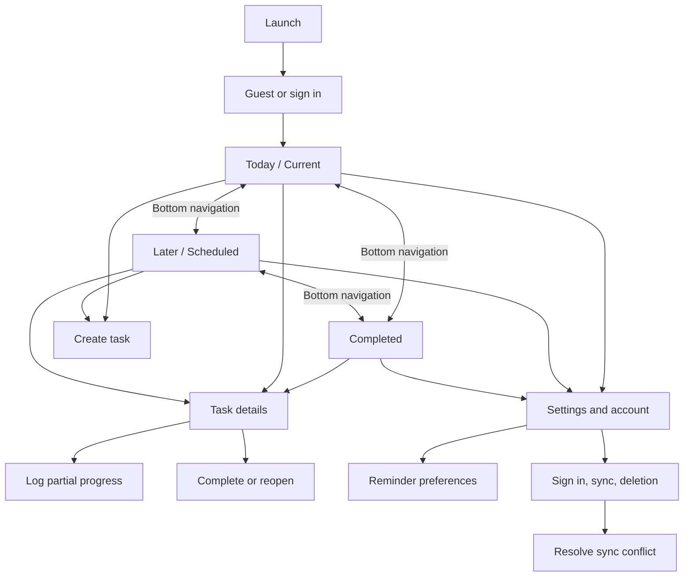
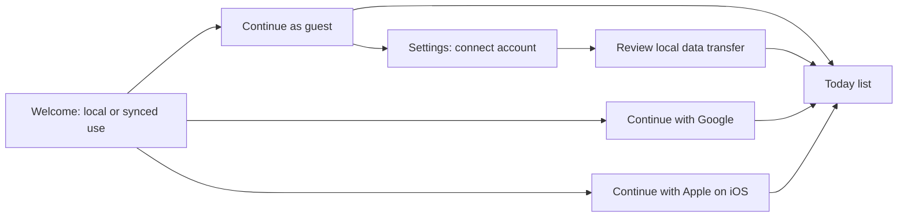
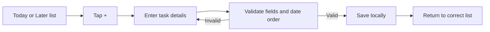

# UI Flow and First-Pass Wireframes

**Project:** Personal and public task planning mobile application  
**Status:** Current clickable preview approved as the visual baseline; detailed MVP flows remain implementation references  
**Version:** 0.1  
**Date:** 16 October 2026  
**Basis:** [FRS.md](FRS.md) v0.5, [HLD.md](HLD.md) v0.4, [LLD.md](LLD.md) v0.4, [Implementation-Roadmap.md](Implementation-Roadmap.md) v0.3

## 1. Purpose and scope

This document turns the agreed MVP requirements into a screen map and simple wireframes. It is a design artifact for review before detailed visual styling or Flutter implementation. It covers the first release only; the calendar and study timer remain deferred.

Open the [clickable browser preview](app-preview.html) to explore the Today, Later, and Completed views and the task flows described here.

## 2. Navigation model

Use a three-destination bottom navigation bar matching the three required task views. Keep task creation available from each destination. Put account, notification, privacy, and app settings behind the profile/settings control in the top bar.



### Global navigation decisions

- Bottom tabs: **Today**, **Later**, **Completed**. Use text labels and icons; the selected tab is not indicated by color alone.
- A floating **+** action opens the task editor. From Today, the start date defaults to today; from Later, it defaults to the next available future date. The user can change either date.
- The app bar shows the screen title, a small offline/sync state when relevant, and a settings/profile button.
- Back navigation preserves the active list and scroll position.
- Do not require sign-in before a user can use guest mode.

## 3. User journeys

### 3.1 First launch and profile choice



Explain the choice in plain language: guest data stays on this device; signing in enables account sync across devices. Link the privacy notice before account creation. On iOS, show Google and Apple sign-in as equivalent choices. Ask for notification permission only when the user enables reminders or reaches the reminder setup flow.

### 3.2 Create a task



Required fields: topic, start date, planned end date, and effort in hours. Optional fields: subtopic, description, and maximum end date. Use the selected LLD limits and date rules. Keep the effort control explicitly labeled **Estimated effort (hours)**; effort is not elapsed time or calendar duration.

### 3.3 Review and update a task

From any task card, open Task Details. The user can edit the task, add partial progress, mark it complete, reopen it when supported, or delete it after confirmation. The detail page shows planned dates, maximum date if set, effort, current status, and dated progress/completion history.

### 3.4 Record partial progress

Select exactly one method: percentage, completed units, or a note. Save creates a dated progress entry and leaves the task open. Repeated entries are allowed. The history view provides edit and delete actions for correcting an entry.

### 3.5 Resolve a sync conflict

When the same task field changed on this device and another device, show the field name, the local value, and the account value. The user selects which value to keep. Explain that the selection applies to that field; keep unrelated edits. Do not silently replace a value.

## 4. Low-fidelity screen layouts

These layouts show information hierarchy and primary actions, not final pixel measurements.

### 4.1 Today / Current

```text
┌──────────────────────────────────┐
│ Today                 Offline  ⚙ │
│ Thursday, 16 October              │
│ 3 tasks · 6.5 h across current    │
├──────────────────────────────────┤
│ TODAY                             │
│ ▌ Review algebra                 │
│ ▌ Chapter 4                      │
│ ▌ Effort 2 h   Due today     ›    │
├──────────────────────────────────┤
│ ▌ Finish assignment              │
│ ▌ Effort 3.5 h  Due 18 Oct   ›    │
├──────────────────────────────────┤
│ ▌ Revise notes                    │
│ ▌ Effort 1 h    Overdue      ›   │
├──────────────────────────────────┤
│                                  │
│                         [  +  ]  │
├──────────────────────────────────┤
│  Today       Later     Completed  │
└──────────────────────────────────┘
```

Show current and overdue open tasks here. If empty, use a calm empty state with **No tasks for today** and a primary **Add a task** action. Display effort and status as text so color is never the only signal. A count-only lock-screen notification is configured separately from this screen.

### 4.2 Later / Scheduled

```text
┌──────────────────────────────────┐
│ Later                  Offline ⚙ │
│ Tasks starting after today       │
├──────────────────────────────────┤
│ NEXT                              │
│ Prepare presentation             │
│ Starts 21 Oct · Ends 24 Oct      │
│ Effort 5 h                  ›    │
├──────────────────────────────────┤
│ 28 October                       │
│ Read research paper              │
│ Starts 28 Oct · Ends 30 Oct      │
│ Effort 2 h                  ›    │
├──────────────────────────────────┤
│                         [  +  ]  │
├──────────────────────────────────┤
│  Today       Later     Completed  │
└──────────────────────────────────┘
```

Sort by start date, then planned end date. Show the date range and effort. Future tasks do not use the current-task effort-green treatment.

### 4.3 Completed

```text
┌──────────────────────────────────┐
│ Completed                 ⚙     │
│ [ Search completed tasks      ]  │
├──────────────────────────────────┤
│ TODAY                            │
│ ✓ Submit lab report              │
│ Completed 10:42 AM · Effort 2 h  │
├──────────────────────────────────┤
│ YESTERDAY                        │
│ ✓ Clean desk                     │
│ Completed 6:15 PM · Effort 1 h   │
├──────────────────────────────────┤
│                                  │
├──────────────────────────────────┤
│  Today       Later     Completed  │
└──────────────────────────────────┘
```

Show most recently completed tasks first. Load older history incrementally; provide search/filter for completed tasks. A completed card has a check icon and the word **Completed**, independent of color.

### 4.4 Create / edit task

```text
┌──────────────────────────────────┐
│ ‹ Back        New task           │
├──────────────────────────────────┤
│ Topic *                           │
│ [                              ] │
│ Subtopic                          │
│ [                              ] │
│ Description                       │
│ [ Add details                  ] │
│                                  │
│ Start date *      Planned end *  │
│ [ 16 Oct       ]  [ 18 Oct     ] │
│ Maximum end date (optional)       │
│ [ Choose date                  ] │
│                                  │
│ Estimated effort (hours) *       │
│ [ 2.5                          ] │
│                                  │
│ [          Save task           ] │
└──────────────────────────────────┘
```

Use a numeric decimal keyboard for effort. Display dates in an unambiguous localized format. Validate end date >= start date and maximum end date >= planned end date. Preserve entered values when showing validation errors.

### 4.5 Task details and progress

```text
┌──────────────────────────────────┐
│ ‹ Back        Task details    ⋮  │
├──────────────────────────────────┤
│ Finish assignment                │
│ Topic / subtopic                 │
│                                  │
│ 16–18 Oct · Max 20 Oct           │
│ Estimated effort       3.5 h     │
│ Status                 Current   │
│                                  │
│ [ Log progress ] [ Complete ]    │
│                                  │
│ Progress history                 │
│ 16 Oct · 50%                     │
│ 15 Oct · Started section 1       │
│                                  │
│ [ Edit task ]                    │
└──────────────────────────────────┘
```

The overflow menu contains Delete, with a clear confirmation that deleting also removes progress and completion history. Reopen appears for completed tasks when enabled.

### 4.6 Partial progress form

```text
┌──────────────────────────────────┐
│ ‹ Back        Log progress       │
├──────────────────────────────────┤
│ Finish assignment                │
│                                  │
│ Progress type                    │
│ (•) Percentage  ( ) Units  ( ) Note│
│                                  │
│ Completed                        │
│ [ 50 ] %                         │
│                                  │
│ Date and time                    │
│ [ Today · Now                 ] │
│                                  │
│ [       Save progress          ] │
└──────────────────────────────────┘
```

Switching the method replaces the method-specific input; do not combine methods in one entry. The note method shows a note field instead of percentage/units.

### 4.7 Reminder settings

```text
┌──────────────────────────────────┐
│ ‹ Settings       Reminders       │
├──────────────────────────────────┤
│ Notifications            [ On ]  │
│ No tasks today                  │
│   First reminder       [ 9:00 ]  │
│   Second reminder      [12:00 ]  │
│ End-of-day log reminder [22:00 ] │
│ Quiet hours             [ Off ]  │
│ Sound                   [ On ]  │
│ Vibration               [ On ]  │
│                                  │
│ Times use India Standard Time.   │
└──────────────────────────────────┘
```

When OS permission is denied, explain how to enable it in system settings and keep all task features available. Quiet hours follow the LLD's same-day defer-or-suppress rule.

### 4.8 Settings, profile, and sync

Include: current profile type (Guest / signed-in provider), sync state, **Connect account** for guests, **Sync now**, notification settings, privacy policy, app licenses, and **Delete account** for signed-in accounts. Account deletion requires re-authentication and displays the 7-day primary-data and 30-day backup windows before final confirmation.

## 5. Effort-based green treatment

Use a deterministic five-level scale based only on estimated hours. Apply the green level to a slim card accent and a labeled effort chip; keep the main task text on a neutral card background for readability.

| Estimated effort | Level | Suggested light-theme indicator |
|---|---|---|
| `0 < h <= 1` | 1 | `#E8F5E9` |
| `1 < h <= 3` | 2 | `#C8E6C9` |
| `3 < h <= 6` | 3 | `#A5D6A7` |
| `6 < h <= 10` | 4 | `#66BB6A` |
| `h > 10` | 5 | `#2E7D32` |

Always show the numeric effort, for example **Effort 3.5 h**, plus an accessible textual description such as **Higher effort** for the level. Use contrast-checked text on the chip; do not rely on the suggested color alone. Define equivalent contrast-safe dark-theme tokens during implementation.

Overdue styling takes precedence over the green accent: use a red accent, an explicit **Overdue** label, and an overdue icon. Continue to show the effort value. Scheduled and completed tasks do not use the green current-task scale.

## 6. Accessibility and interaction rules

- Every interactive control has a screen-reader label; icons that communicate status have accompanying text.
- Respect system text scaling and support light/dark appearance.
- Meet contrast requirements for text and interactive controls; test each status token in both themes.
- Keep touch targets comfortable for one-handed use and place the primary action within reach on long forms.
- Use confirmation for destructive task/account deletion, with a clear cancel action.
- Show pending/offline/sync-failed state without blocking local task use.
- Preserve keyboard focus, entered form values, and scroll position when navigating back from an error or detail view.
- Do not use color as the sole encoding of effort, overdue, completion, selection, or sync state.

## 7. Notification and platform boundaries

- Notifications are an OS-controlled surface and may be dismissed. The app does not promise an uncloseable permanent task notification.
- Default lock-screen content is a privacy-safe count, not topic/subtopic text.
- Tapping a daily summary opens Today; tapping an end-of-day reminder opens the tasks that still need a log.
- Calendar and study-timer destinations are not shown in the MVP navigation.

## 8. Review checklist for the wireframes

- Do the three bottom tabs make the required task views easy to find?
- Is creating a task reachable in one action from the task lists?
- Is the distinction between effort hours and date duration clear?
- Can the user identify current, overdue, scheduled, and completed tasks without interpreting color?
- Are progress method choices understandable and mutually exclusive?
- Is guest-vs-account data behavior clear before a user chooses sign-in or transfer?
- Are reminders, sign-in, and deletion transparent about OS or retention constraints?


